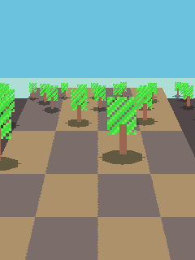
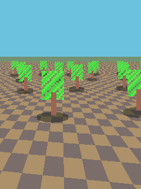
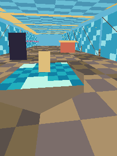
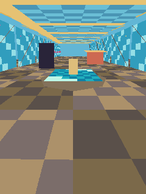
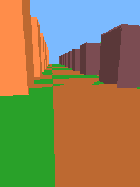

# VXPEngine 2.5D / 3D graphics checks

The opt-in test renderer is `engine/coremre/tests/vxpe_graphics_benchmark.cpp`. It measures a drifting 48-billboard 2.5D scene, a game-shaped 2.5D scene (camera-anchored perspective ground plus 48 depth-sorted billboard trees with projected shadows), a textured retro-mall walkthrough, and a low-poly 3D plaza with depth-tested faces. The textured mall uses generated 8×8 RGB565 floor, glass, roof, and water maps; per-face fixed illumination stands in for baked lighting, while the fountain surface, fish and camera animate from lookup tables. Its arcade/pizza signage is abstract and original. The plaza runs with exact perspective depth and opt-in affine depth. Each mode is measured at 120×160 and 240×320; buffer sizes are reported alongside median frame times.

## Host run

Configure the host test directory, build `vxpe_graphics_benchmark`, then run it with a sample count:

```powershell
cmake -S engine/coremre/tests -B tmp/graphics-benchmark -G Ninja
cmake --build tmp/graphics-benchmark --target vxpe_graphics_benchmark
tmp/graphics-benchmark/vxpe_graphics_benchmark.exe 16
```

The host clock is affected by CPU scheduling and power management, so use these values to compare code paths on the same machine. They are not S30+ FPS claims.

One 16-frame run on the VXPEngine development PC:

| Path | Resolution | Median time | Pixel storage |
|---|---:|---:|---:|
| 2.5D billboards | 120×160 | 0.170 ms/frame | 38,400 B color |
| 2.5D billboards | 240×320 | 0.576 ms/frame | 153,600 B color |
| 2.5D ground+batch | 120×160 | 0.210 ms/frame | 38,400 B color |
| 2.5D ground+batch | 240×320 | 0.725 ms/frame | 153,600 B color |
| 3D textured mall | 120×160 | 2.398 ms/frame | 76,800 B color + depth |
| 3D textured mall | 240×320 | 8.692 ms/frame | 307,200 B color + depth |
| 3D exact depth, flat plaza | 120×160 | 1.378 ms/frame | 76,800 B color + depth |
| 3D affine depth, flat plaza | 120×160 | 0.884 ms/frame | 76,800 B color + depth |
| 3D exact depth, flat plaza | 240×320 | 4.706 ms/frame | 307,200 B color + depth |
| 3D affine depth, flat plaza | 240×320 | 2.930 ms/frame | 307,200 B color + depth |

This run was taken on 2026-10-11 after the ground step-scale fix in `vxpe25d_draw_ground` (the per-pixel world step was 256× too small with a level camera, so tiled floors varied only row-to-row; the row-start texture phase is now kept in Q16 texels instead of being truncated to whole world units); the ground+batch reference checksums changed with it. Earlier runs recorded 0.559 ms for the 240×320 billboard path and 8.434 ms for the textured mall; the 3D paths shift between runs with CPU scheduling, so compare rows only within a single run.

The `2.5D ground+batch` row measures the game-shaped 2.5D scene: one camera-anchored perspective ground pass (`vxpe25d_draw_ground`, tiled 8×8 floor, row fog) plus 48 billboard trees pushed in unsorted order through `vxpe25d_batch_flush`, which projects, culls, depth-sorts far-to-near and draws each tree's projected ground shadow. At 240×320 it costs 0.15 ms more than the hand-ordered billboard row in this run, so correct per-frame sorting and a full perspective-correct ground are affordable at QVGA. Checksums for the reference frame (phase 20): `1E6C0940283BFD9A` at 120×160, `181D66D8710A1531` at 240×320.

In this run, affine depth was 1.56× faster at 120×160 and 1.61× at 240×320. It changed 131/19,200 pixels at 120×160 and 721/76,800 pixels at 240×320 in this overlapping plaza scene. The changes cluster around depth intersections, so affine depth remains opt-in and should be used only for separated flat faces. Textured, fogged, smooth-lit, and overlap-sensitive faces should use exact depth. The textured mall costs more than flat faces, which is the expected quality/performance tradeoff; render it at half resolution for S30+.

## Rendering choice

Use 2.5D billboards and projected planes when the scene is built from sprites; `vxpe25d_batch_flush` removes the need for a predictable push order by sorting projected entries far-to-near itself, and `vxpe25d_draw_ground` keeps tiled floors locked to the world while the camera drives and yaws. The 2.5D path has no depth buffer and uses half the color RAM of the 120×160 3D target. Use the 3D renderer when objects need arbitrary camera orientation and per-pixel occlusion; 120×160 color plus depth costs 76.8 KB and retains full 3D perspective. On 32-bit ARM, stepped quotient/remainder interpolation now covers exact reciprocal depth and perspective UV weights. A regular and forced-path host benchmark produced identical image checksums for the textured mall at both sizes (`1A09E13438A6E3FB` at 120×160; `E98427829E3CDD87` at 240×320) and for the exact-depth plaza (`4EF4962D9063D95B`; `75114656622C3161`). ARMv5TE compilation and regular/forced regression suites passed. Forced-host timings are not useful for ARM speed estimates; device-side frame timings still need measurement on the target handset.

The playable `examples/LostLatencyMallDemo` uses the same 120×160 software 3D target. Since its sky gradient replaces every color pixel, depth-only clearing removes 38,400 redundant RGB565 writes (76,800 bytes written) from each world frame, without changing the captured PPM image (pre/post SHA-256 matched). Core rasterization also skips triangles whose projected bounds are fully offscreen. The mall gameplay regression and ARM VXP build pass with these paths enabled.

## Reference images











